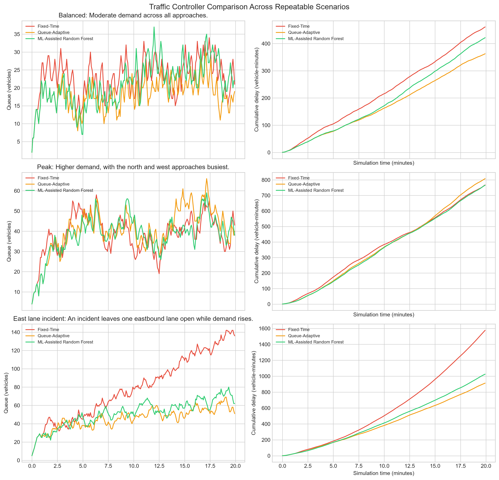

# TrafficMindAI

<p align="center">
  <strong>AI-Assisted Adaptive Traffic Signal Control</strong><br />
  A simulation-first prototype for exploring traffic-signal strategies with a machine-learning-assisted controller.
</p>

<p align="center">
  
  
  
  
</p>

TrafficMindAI is a browser-based traffic-intersection simulation that compares conventional fixed-time signals with queue-aware and Random Forest-assisted adaptive strategies. It brings together an interactive dashboard, configurable traffic scenarios, simulation metrics, and a lightweight Python API for model inference.

> **Scope:** TrafficMindAI is a research and demonstration prototype. It uses synthetic traffic conditions and is not connected to live road sensors or real traffic-signal infrastructure.

## Contents

- [Highlights](#highlights)
- [How It Works](#how-it-works)
- [Technology Stack](#technology-stack)
- [Repository Structure](#repository-structure)
- [Getting Started](#getting-started)
- [Run a Benchmark](#run-a-benchmark)
- [API Endpoints](#api-endpoints)
- [Benchmark Visualization](#benchmark-visualization)
- [Limitations](#limitations)
- [Roadmap](#roadmap)

## Highlights

- **Four-way intersection simulation** with North, East, South, and West approaches.
- **Controller comparison** across Fixed-Time, Queue-Based Adaptive, and ML-Assisted Adaptive strategies.
- **Multiple scenarios** representing balanced demand, morning peak traffic, a lane incident, reduced capacity in rainy conditions, and emergency-response demonstrations.
- **Interactive playback** to run, pause, and inspect a simulated traffic timeline.
- **Performance metrics** for queue lengths, vehicles served, and accumulated vehicle delay.
- **Emergency vehicle demonstrations** to explore how controller choices affect simulated emergency approaches.
- **Random Forest inference API** that estimates green-light duration from simulated traffic-state features.
- **Repeatable benchmark script** that trains the model on synthetic heuristic targets and generates controller-comparison plots.

## How It Works

```text
┌──────────────────────────────┐
│  Browser Dashboard            │
│  HTML · CSS · JavaScript      │
└──────────────┬───────────────┘
               │ Simulated traffic state
               ▼
┌──────────────────────────────┐
│  Traffic Simulation           │
│  Fixed-Time / Queue-Based / ML │
└──────────────┬───────────────┘
               │ ML prediction requests
               ▼
┌──────────────────────────────┐
│  Python API                   │
│  Random Forest · joblib       │
└──────────────────────────────┘

┌──────────────────────────────┐
│  traffic_sim.py               │
│  Synthetic benchmark + chart  │
└──────────────────────────────┘
```

1. The dashboard simulates vehicle arrivals and signal operation at a four-way junction.
2. The Fixed-Time controller follows a predetermined rotation; the Queue-Based controller prioritizes queues and waiting time.
3. The ML-Assisted controller requests green-time estimates from the Random Forest model through the local Python API.
4. The benchmark script trains the model on a synthetic heuristic target and compares the controllers under repeatable scenarios.

The model's speed and occupancy inputs are proxies derived from the simulated queue length—not independent measurements from physical sensors.

## Technology Stack

| Area | Technologies |
|---|---|
| Interactive dashboard | HTML5, CSS3, JavaScript |
| Local server and API | Python standard library (`http.server`) |
| Machine learning | Scikit-learn, Random Forest Regressor |
| Model serialization | Joblib |
| Data processing | NumPy, pandas |
| Benchmark charts | Matplotlib |

## Repository Structure

```text
TrafficMindAI/
├── backend.py                 # Local dashboard server and prediction API
├── traffic_sim.py             # Synthetic traffic simulation and benchmark runner
├── traffic_rf_model.pkl       # Serialized Random Forest model
├── traffic_dashboard.html     # Dashboard interface
├── traffic_dashboard.css      # Dashboard styling
├── traffic_dashboard.js       # Browser simulation and visualizations
├── simulation_benchmark.png   # Generated benchmark chart
├── .gitignore
└── README.md
```

## Getting Started

### Prerequisites

- Python 3
- `pip`
- A modern web browser

### 1. Clone the repository

```bash
git clone https://github.com/ankush962/TrafficMindAI.git
cd TrafficMindAI
```

### 2. Create a virtual environment

**macOS / Linux**

```bash
python3 -m venv .venv
source .venv/bin/activate
```

**Windows PowerShell**

```powershell
python -m venv .venv
.\.venv\Scripts\Activate.ps1
```

### 3. Install dependencies

```bash
python -m pip install --upgrade pip
python -m pip install joblib matplotlib numpy pandas scikit-learn
```

### 4. Configure the model location

`backend.py` supports the `TRAFFIC_ML_DIR` environment variable to locate `traffic_rf_model.pkl`. Set it to the repository directory before starting the server.

**macOS / Linux**

```bash
export TRAFFIC_ML_DIR="$PWD"
```

**Windows PowerShell**

```powershell
$env:TRAFFIC_ML_DIR = (Get-Location).Path
```

### 5. Start TrafficMindAI

```bash
python backend.py
```

The dashboard should open automatically. If it does not, visit:

**[http://127.0.0.1:8765/traffic_dashboard.html](http://127.0.0.1:8765/traffic_dashboard.html)**

The API health endpoint is available at [http://127.0.0.1:8765/api/health](http://127.0.0.1:8765/api/health). Keep the terminal open while using the dashboard. Press `Ctrl+C` to stop the server.

> **Model compatibility:** The serialized model must be compatible with the installed scikit-learn version. If loading the model fails, install a compatible version or retrain it using the benchmark script below.

## Run a Benchmark

With the virtual environment active and the project directory as the current working directory, run:

```bash
python traffic_sim.py
```

The script trains and saves `traffic_rf_model.pkl`, evaluates the three controller strategies across the benchmark scenarios, prints a summary to the terminal, and regenerates `simulation_benchmark.png`.

If you retrain the model while the server is running, restart `backend.py` to load the newly generated model.

## API Endpoints

### `GET /api/health`

Returns the local API status, model filename, and feature names.

### `POST /api/predict`

Accepts one or more simulated traffic observations and returns predicted green-light durations.

Example request body:

```json
{
  "observations": [
    {
      "queue_length": 12,
      "arrival_rate_veh_per_step": 1.0,
      "approach_wait_sec": 25,
      "lanes_open": 2
    }
  ]
}
```

The API derives proxy values for average speed and occupancy from queue length, then returns a `green_seconds` array. Requests are intended for local simulation use.

## Benchmark Visualization

The chart below is generated by `traffic_sim.py`. It compares queue length and cumulative delay over time for the three controllers in synthetic scenarios.



## Limitations

- **Synthetic environment:** Vehicle arrivals, road conditions, and emergency events are simulated rather than taken from live traffic feeds.
- **Heuristic training target:** The Random Forest learns to imitate a rule-based green-time heuristic; it is not trained on a labelled dataset of real traffic-control decisions.
- **Estimated features:** Speed and occupancy are derived from queue length and should not be interpreted as real sensor measurements.
- **Simulation results only:** Outcomes depend on the scenario assumptions and do not demonstrate real-world improvements or prove an optimal traffic policy.
- **No field deployment:** The prototype has no direct connection to traffic controllers, roadside sensors, cameras, or municipal systems.

## Roadmap

- [ ] Evaluate strategies over more random seeds and report aggregate results.
- [ ] Add tests for simulation logic and API validation.
- [ ] Document model-training metrics and benchmark methodology.
- [ ] Explore validated real-world traffic datasets and more realistic junction dynamics.
- [ ] Add pedestrian phases and additional safety constraints to the simulation.
- [ ] Consider authorized sensor or traffic-system integrations only after validation and safety review.

## License

No license file is currently included. Until a license is added, assume that standard copyright restrictions apply to reuse and redistribution.

---

Built as an AI-assisted traffic simulation prototype. Contributions, issues, and constructive feedback are welcome.
